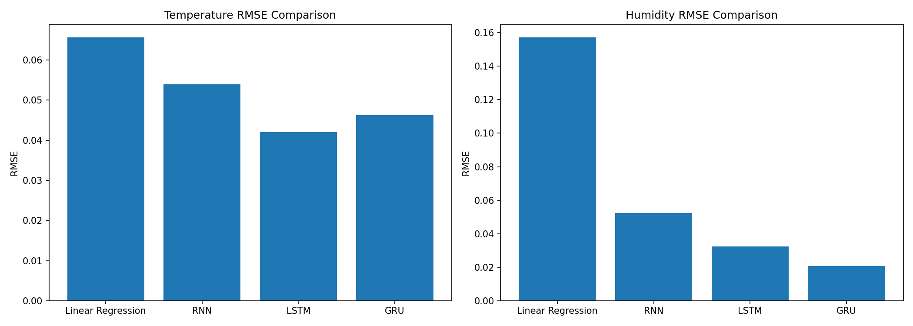
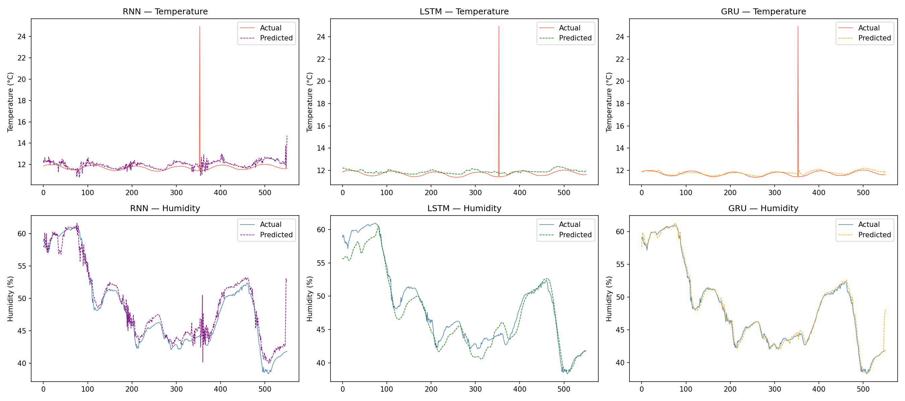
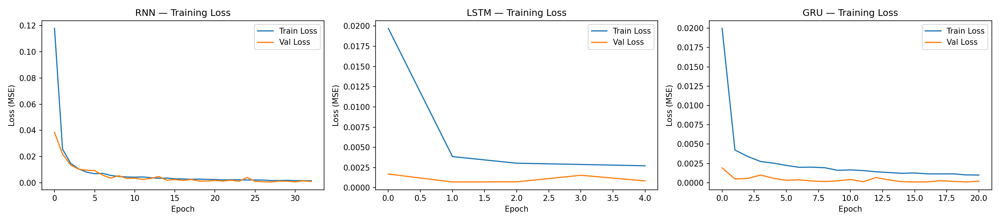

# Smart Home Adaptive Control

A simulated smart-home controller that forecasts indoor temperature and humidity every 15 minutes and decides which actuators to trigger to keep the room comfortable.

## Overview

The system reads sensor and weather data, predicts the next indoor temperature and humidity, and applies rule-based control logic on top of those predictions. Four forecasting models are trained and compared: Linear Regression (baseline), RNN, LSTM and GRU.

## Control Constraints Modelled

- **Mechanical ventilation:** moves indoor temperature, humidity and CO2 toward outdoor conditions (outdoor CO2 fixed at 250 ppm). It takes 15 minutes to operate, indoor conditions revert within 15 minutes of deactivation, and it overrides all other control methods.
- **Storage heaters:** raise indoor temperature by 0.5 C after 15 minutes of operation. The effect lasts 4 hours, and the heaters can be activated at most twice per day.
- **Interaction:** if both are active at the same time, ventilation takes precedence and the heating effect is cancelled.

## Pipeline

1. Preprocessing: datetime indexing, missing-value handling, removal of non-numeric columns, MinMax scaling
2. Feature selection based on physically meaningful variables
3. Sliding-window sequences (last 10 readings, equal to 2.5 hours, predict the next reading) with a chronological 80/20 train/test split
4. Training and comparison of Linear Regression, RNN, LSTM and GRU using MAE, RMSE and R2
5. Adaptive control logic driven by the best model's predictions
6. Output of predicted values and control actions, one row per 15-minute interval, to `results/final_predictions_with_control.csv`

## Results

The recurrent models (RNN, LSTM, GRU) clearly outperformed the Linear Regression baseline. GRU gave the best humidity predictions, with an R2 of about 0.99 on the test set. Temperature was harder to predict for every model. The full comparison is in the notebook.







## Repository Structure

```
.
├── smart_home_adaptive_control.ipynb
├── requirements.txt
├── data/
│   └── README.md
└── results/
    ├── final_predictions_with_control.csv
    ├── model_comparison.png
    ├── training_loss.png
    ├── rnn_lstm_gru_predictions.png
    ├── lr_predictions.png
    └── targets_over_time.png
```

## Running the Notebook

```bash
git clone https://github.com/haneen09/smart-home-adaptive-control.git
cd smart-home-adaptive-control
pip install -r requirements.txt
jupyter notebook smart_home_adaptive_control.ipynb
```

Download the dataset (see below) and save it as `data/6FTC2088-1.csv` before running.

## Dataset

Adapted from the Kaggle competition [Smart Homes Temperature Time Series Forecasting](https://www.kaggle.com/competitions/smart-homes-temperature-time-seriesforecasting). The data is not redistributed in this repository. Please download it from Kaggle and follow its terms of use.

## Limitations and Future Work

- The dataset covers a short time span, so seasonal effects are not captured.
- Control is simulated and has not been tested on real hardware.
- Possible next steps: hyperparameter tuning, multi-step forecasting, and reinforcement-learning-based control.

## Tech Stack

Python, pandas, NumPy, scikit-learn, TensorFlow/Keras, Matplotlib

## Author

Haneen Aly - [GitHub](https://github.com/haneen09)
